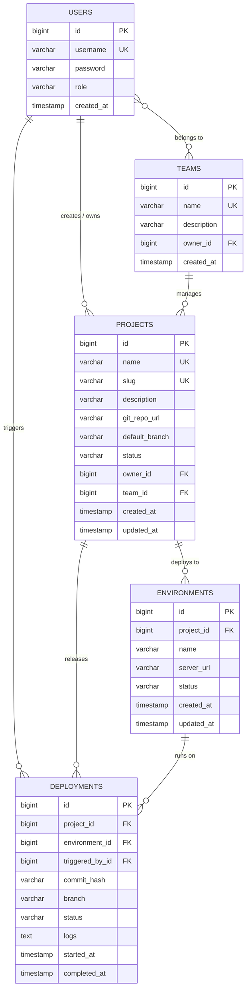

# DevOpsHub: Master Engineering Specification & Domain Architecture 🛠️

> [!IMPORTANT]
> **The Immutable Source of Truth:**  
> This specification defines the complete real-world domain, database schema, entity relationships, REST contracts, and business logic for the **DevOpsHub Developer Platform**.  
> Every phase of development references this blueprint to guarantee consistency, data integrity, and zero architectural drift.

---

## 1. What is DevOpsHub? (The Product Blueprint)

In modern software organizations, engineering teams juggle hundreds of microservices, multiple deployment environments (Dev, Staging, Prod), and automated releases. 

**DevOpsHub** is a centralized developer operations platform (inspired by GitHub, ArgoCD, and AWS Management Console) that allows engineering teams to:
1. **Manage Projects & Services:** Register services with their Git repository URLs, description, default branches, and health status.
2. **Organize Teams:** Group engineers into Teams (e.g. *"Platform Engineering"*, *"Payment Core"*) with role-based access.
3. **Track Infrastructure Environments:** Monitor deployment targets (`DEV`, `STAGING`, `PRODUCTION`) with live health checks (`HEALTHY`, `DEGRADED`, `DOWN`).
4. **Orchestrate Deployments:** Trigger and track release deployments across environments with Git commit hashes, release branches, and execution logs (`PENDING`, `IN_PROGRESS`, `SUCCESS`, `FAILED`).

---

## 2. Complete Relational Database Architecture (ER Diagram)

---

## 3. The 5 Core Domain Entities

### Entity 1: `User` (Authentication & Ownership)
* **Table:** `users`
* **Purpose:** Represents engineers and administrators in the system.
* **Fields:**
  * `id` (`Long`, PK, Auto-increment)
  * `username` (`String`, Unique, Not Null, e.g. `"shyam_lead"`)
  * `password` (`String`, BCrypt Hashed, Not Null)
  * `role` (`String`, e.g. `"ADMIN"`, `"USER"`)
  * `createdAt` (`LocalDateTime`)

---

### Entity 2: `Project` (The Core Service Asset)
* **Table:** `projects`
* **Purpose:** Represents an application or microservice managed by DevOpsHub.
* **Fields:**
  * `id` (`Long`, PK, Auto-increment)
  * `name` (`String`, Unique, Not Null, e.g. `"Payment Gateway Service"`)
  * `slug` (`String`, Unique, Not Null, URL-friendly e.g. `"payment-gateway-service"`)
  * `description` (`String`, Max 500 chars, e.g. `"Core financial transaction processing engine."`)
  * `gitRepoUrl` (`String`, Not Null, Valid URL e.g. `"https://github.com/myorg/payment-service"`)
  * `defaultBranch` (`String`, Default: `"main"`)
  * `status` (`ProjectStatus` Enum: `ACTIVE`, `MAINTENANCE`, `ARCHIVED`)
  * `owner` (`User`, `@ManyToOne`, Not Null)
  * `team` (`Team`, `@ManyToOne`, Nullable)
  * `createdAt` (`LocalDateTime`, Immutable)
  * `updatedAt` (`LocalDateTime`)

---

### Entity 3: `Environment` (Infrastructure Targets)
* **Table:** `environments`
* **Purpose:** Represents a runtime target where a project runs.
* **Fields:**
  * `id` (`Long`, PK, Auto-increment)
  * `project` (`Project`, `@ManyToOne`, Not Null)
  * `name` (`EnvironmentType` Enum: `DEV`, `STAGING`, `PRODUCTION`)
  * `serverUrl` (`String`, e.g. `"https://payment-dev.internal.devopshub.com"`)
  * `status` (`EnvironmentStatus` Enum: `HEALTHY`, `DEGRADED`, `DOWN`, `UNKNOWN`)
  * `createdAt` (`LocalDateTime`)
  * `updatedAt` (`LocalDateTime`)

---

### Entity 4: `Deployment` (Release Pipeline Orchestration)
* **Table:** `deployments`
* **Purpose:** Records an automated or manual release into an environment.
* **Fields:**
  * `id` (`Long`, PK, Auto-increment)
  * `project` (`Project`, `@ManyToOne`, Not Null)
  * `environment` (`Environment`, `@ManyToOne`, Not Null)
  * `triggeredBy` (`User`, `@ManyToOne`, Not Null)
  * `commitHash` (`String`, Length 40 or 7, e.g. `"7f3b89a"`)
  * `branch` (`String`, Not Null, e.g. `"main"`)
  * `status` (`DeploymentStatus` Enum: `PENDING`, `IN_PROGRESS`, `SUCCESS`, `FAILED`, `ROLLED_BACK`)
  * `logs` (`String`, Text format build/deployment output)
  * `startedAt` (`LocalDateTime`)
  * `completedAt` (`LocalDateTime`, Nullable until finished)

---

### Entity 5: `Team` (Collaboration & Access Control)
* **Table:** `teams`
* **Purpose:** Groups users and projects under engineering organizations.
* **Fields:**
  * `id` (`Long`, PK, Auto-increment)
  * `name` (`String`, Unique, Not Null, e.g. `"Platform Engineering"`)
  * `description` (`String`)
  * `owner` (`User`, `@ManyToOne`)
  * `createdAt` (`LocalDateTime`)

---

## 4. The Domain Enums

Strict enums eliminate string typo bugs:

1. **`ProjectStatus`**:
   * `ACTIVE`: Service actively running in production and development.
   * `MAINTENANCE`: Service undergoing scheduled maintenance or database migration.
   * `ARCHIVED`: Service decommissioned or read-only.
2. **`EnvironmentType`**:
   * `DEV`: Local/sandbox testing environment.
   * `STAGING`: Pre-production environment mimicking production configuration.
   * `PRODUCTION`: Mission-critical live customer environment.
3. **`EnvironmentStatus`**:
   * `HEALTHY`: 100% of health check endpoints returning 200 OK.
   * `DEGRADED`: Partial latency or secondary node outage.
   * `DOWN`: Service unreachable.
4. **`DeploymentStatus`**:
   * `PENDING`: Queued in pipeline.
   * `IN_PROGRESS`: Container image building or rolling update deploying.
   * `SUCCESS`: Health check passed after deployment.
   * `FAILED`: Deployment script failed or health check timeout.
   * `ROLLED_BACK`: Automatically reverted to previous stable commit hash.

---

## 5. Complete REST API Matrix

| Module | HTTP Verb | Route | Access Role | Description |
|---|---|---|---|---|
| **Auth** | `POST` | `/api/auth/register` | Public | Register new user account |
| **Auth** | `POST` | `/api/auth/login` | Public | Authenticate user & issue JWT |
| **Projects** | `GET` | `/api/projects` | `USER`, `ADMIN` | List all projects (with Pagination & Search) |
| **Projects** | `GET` | `/api/projects/{id}` | `USER`, `ADMIN` | Get single project details |
| **Projects** | `POST` | `/api/projects` | `ADMIN` | Create a new project |
| **Projects** | `PUT` | `/api/projects/{id}` | `ADMIN` | Update project metadata |
| **Projects** | `DELETE` | `/api/projects/{id}` | `ADMIN` | Archive / Delete project |
| **Environments**| `GET` | `/api/projects/{projectId}/environments` | `USER`, `ADMIN` | List environments for a project |
| **Environments**| `POST` | `/api/projects/{projectId}/environments` | `ADMIN` | Add an environment (DEV/STAGE/PROD) |
| **Environments**| `PATCH`| `/api/environments/{id}/status` | `ADMIN` | Update health status (HEALTHY/DOWN) |
| **Deployments** | `GET` | `/api/projects/{projectId}/deployments` | `USER`, `ADMIN` | View deployment history |
| **Deployments** | `POST` | `/api/projects/{projectId}/deployments` | `ADMIN` | Trigger a new deployment run |
| **Deployments** | `GET` | `/api/deployments/{id}` | `USER`, `ADMIN` | Inspect deployment status & logs |
| **Teams** | `GET` | `/api/teams` | `USER`, `ADMIN` | List all teams |
| **Teams** | `POST` | `/api/teams` | `ADMIN` | Create an engineering team |

---

## 6. The 4-Stage Systematic Implementation Plan

We build DevOpsHub module by module, following the **7-Step Engineering Lifecycle** for every module:

### 📍 Stage 1: The Core Project & Repository Engine (Immediate Focus)
* Upgrade `Project` entity (`gitRepoUrl`, `slug`, `description`, `defaultBranch`, `ProjectStatus`).
* JPA Auditing (`createdAt`, `updatedAt`).
* Validation DTOs: `ProjectCreateRequest` and `ProjectResponse`.
* Repository with slug lookup and custom query methods.
* Service layer with business rules (duplicate name/slug prevention).
* Controller with RESTful 201 Created responses.
* Test suite regression (Unit, Slice, Security, E2E).
* Swagger UI schema documentation.

### 📍 Stage 2: Environments Management
* Create `Environment` entity and `EnvironmentType` & `EnvironmentStatus` enums.
* Connect `Environment` to `Project` via `@ManyToOne`.
* Build CRUD endpoints for environments.
* Write slice and integration tests.

### 📍 Stage 3: Deployment Pipeline Engine
* Create `Deployment` entity and `DeploymentStatus` enum.
* Connect `Deployment` to `Project`, `Environment`, and `User`.
* Build deployment triggering service with simulated build logs.
* Full test coverage.

### 📍 Stage 4: Teams & Access Control
* Create `Team` entity.
* Associate Teams with Users and Projects.
* Enforce Team-level permissions.
