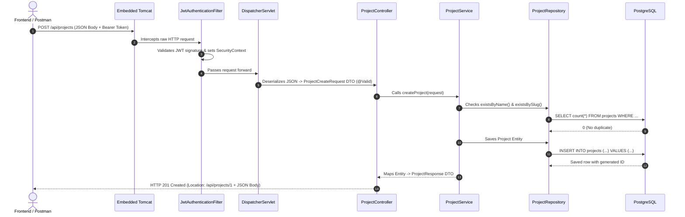

# The Big Picture: What is a REST API? (From First Principles to Enterprise Scale) 🌐

> *"If you cannot explain it simply, you do not understand it well enough."*  
> This guide demystifies the entire concept of REST APIs: why they exist, what the name actually means, how data travels across the globe, and the difference between basic REST and high-scale enterprise engineering.

---

## 1. Why Do APIs Exist? (The Universal Problem)

Imagine the real world:
* An iPhone user opens an app written in **Swift / iOS**.
* An Android user opens an app written in **Kotlin**.
* A web browser runs code written in **JavaScript / TypeScript**.
* Another microservice runs code written in **Go / Python**.

Now, all of these different devices need to access the **exact same data** stored inside your **PostgreSQL database** on a cloud server.

```mermaid
flowchart TD
    iPhone[iPhone App \n Swift] -->? Server[PostgreSQL Database \n & Java Backend]
    Android[Android App \n Kotlin] -->? Server
    Browser[Web Browser \n React / JS] -->? Server
    Microservice[Payment Engine \n Go] -->? Server
```

### Why can't the iPhone app connect directly to PostgreSQL?
1. **Security Catastrophe**: You would have to give every phone on the planet the database username and password! A hacker could decompile the mobile app and run `DROP DATABASE`.
2. **Coupling**: If you ever alter a column name in PostgreSQL (`git_repo_url` $\rightarrow$ `repository_url`), every iPhone app on earth would crash instantly until users updated the App Store!
3. **Business Logic Bypass**: If a phone writes directly to the database, who checks if their payment cleared? Who checks if their account is banned? Nobody!

### The Solution: The API (The Bouncer & Receptionist)
You put a **Server (Spring Boot)** in front of your database.  
Nobody touches the database except Spring Boot.  
Clients can only talk to Spring Boot through a standardized language. That interface is called an **API** (*Application Programming Interface*).

---

## 2. What Does "REST" Actually Mean? (No Academic Jargon)

**REST** stands for **REpresentational State Transfer**.  
Invented by Roy Fielding in 2000, it sounds complicated, but broken down into plain words:

```
[Resource State] ---> (Serialized to JSON Representation) ---> [Transferred across the Wire]
```

### Let's decode the three words:
1. **Resource**: Anything your system cares about that can be named with a noun.
   * A `Project`, a `User`, an `Environment`, an `Invoice`.
2. **Representation**: How that resource looks when packaged for travel.
   * In Java memory, a Project is a complex binary memory object (`byte[]`, pointers, heap references).
   * But an iPhone or a browser doesn't know Java memory!
   * So we turn it into a universal text representation: **JSON**!
3. **State Transfer**: 
   * When you make a `GET` request, the server **transfers the current state** of the resource to you in JSON.
   * When you send a `POST` or `PUT`, you **transfer a new state** from your client to the server.

---

## 3. The 4 Fundamental Pillars of REST Architecture

To be truly "RESTful", an API follows 4 universal rules:

```
                ┌────────────────────────────────────────────────────────┐
                │                  THE 4 PILLARS OF REST                 │
                └────────────────────────────────────────────────────────┘
                    │                   │                   │          │
         ┌──────────┴────────┐ ┌────────┴─────────┐ ┌───────┴──────┐ ┌─┴────────────┐
         │ 1. Nouns, Not     │ │ 2. Standard HTTP │ │ 3. Standard  │ │ 4. Stateless │
         │    Verbs (URIs)   │ │    Verbs         │ │ Status Codes │ │    Requests  │
         └───────────────────┘ └──────────────────┘ └──────────────┘ └──────────────┘
```

### Pillar 1: URIs are Nouns (Resources), NEVER Verbs
* ❌ **Old RPC Style (Bad)**:
  * `/api/getAllProjects`
  * `/api/createNewProject`
  * `/api/deleteProjectById?id=5`
* ✅ **RESTful Style (Clean & Universal)**:
  * `/api/projects`
  * `/api/projects/5`
  * The URL only names the **thing (the resource)**, never the action!

### Pillar 2: The HTTP Method Dictates the Action (Verbs)
Because the URI is just a noun, the action is defined by the **HTTP Verb**:

| HTTP Verb | Action on Resource | Database Operation | Idempotent? |
|---|---|---|---|
| **`GET`** | Read / Retrieve | `SELECT` | Yes (safe, never mutates data) |
| **`POST`** | Create a new resource | `INSERT` | No (calling twice creates 2 items) |
| **`PUT`** | Completely replace an existing resource | `UPDATE` (full) | Yes (replacing 5 times produces same result) |
| **`PATCH`** | Partially update specific fields | `UPDATE` (partial) | Usually |
| **`DELETE`**| Remove a resource | `DELETE` | Yes (deleting an already deleted item has same outcome) |

### Pillar 3: Standard Status Codes (The Universal Traffic Lights)
Instead of returning a message string like `"Error: Not found"` with HTTP 200, REST uses the universal HTTP status code system:
* **`2xx` = Success**: `200 OK` (read/updated), `201 Created` (new resource saved), `204 No Content` (deleted).
* **`4xx` = Client Mistake**: `400 Bad Request` (validation failed), `401 Unauthorized` (no token), `403 Forbidden` (no permission), `404 Not Found` (doesn't exist), `409 Conflict` (duplicate name/slug).
* **`5xx` = Server Mistake**: `500 Internal Server Error` (unhandled null pointer, database crashed).

### Pillar 4: Statelessness
The server **never remembers who you are between requests in session memory**.  
Every single request must include its own proof of identity (the **JWT Bearer Token** in the `Authorization` header).  
*Why?* If you have 50 backend servers behind a load balancer, any server can handle any request without sharing session state!

---

## 4. End-to-End Journey of a Single REST Request

Here is the mechanical reality of what happens when a client calls your Spring Boot API:



---

## 5. The REST Maturity Model: What You Have vs What Lies Ahead

How do you know if an API is a "toy" or "enterprise-grade"?  
The software industry uses the **Richardson Maturity Model** (and modern scalability extensions):

```
                       ┌──────────────────────────────────────────────────┐
                       │  LEVEL 4: Advanced Enterprise Reliability        │
                       │  (Idempotency Keys, Rate Limiting, 202 Async)    │
                       └──────────────────────────────────────────────────┘
                                                ▲
                       ┌──────────────────────────────────────────────────┐
                       │  LEVEL 3: Enterprise Scale & Performance         │
                       │  (Pagination, Sorting, ETags, API Versioning)    │
                       └──────────────────────────────────────────────────┘
                                                ▲
                       ┌──────────────────────────────────────────────────┐
                       │  ★ LEVEL 2: Robust REST & Security (YOU ARE HERE)│
                       │  (DTOs, Validation, ExceptionAdvice, JWT, Tests) │
                       └──────────────────────────────────────────────────┘
                                                ▲
                       ┌──────────────────────────────────────────────────┐
                       │  LEVEL 1: Resources & Endpoints                  │
                       │  (Individual URIs /api/projects/1, raw entities) │
                       └──────────────────────────────────────────────────┘
                                                ▲
                       ┌──────────────────────────────────────────────────┐
                       │  LEVEL 0: The "Cream Layer" / Toy Code           │
                       │  (Single URI, 200 OK everywhere, no validation)  │
                       └──────────────────────────────────────────────────┘
```

---

## 6. The Deep Enterprise Topics (Explained Simply)

Here are the concepts that differentiate a basic REST API from one that scales to millions of users:

### Topic 1: Pagination & Slices (`Pageable`)
* **The Problem**: A table has 2,000,000 projects. A query `SELECT * FROM projects` will load all 2 million rows into Java heap memory, instantly freezing your server and crashing with `java.lang.OutOfMemoryError`.
* **The Solution**: The client must request data in "pages":
  ```http
  GET /api/projects?page=0&size=20&sort=createdAt,desc
  ```
  Spring Data translates this into SQL:
  ```sql
  SELECT * FROM projects ORDER BY created_at DESC LIMIT 20 OFFSET 0;
  ```

### Topic 2: Conditional Requests & ETags (`304 Not Modified`)
* **The Problem**: A frontend dashboard polls `/api/projects/1` every 10 seconds to check for updates. Sending the full 5KB JSON every 10 seconds wastes huge internet bandwidth.
* **The Solution**: The server generates a hash fingerprint of the data called an **`ETag`** (`W/"686897696a7c8"`).
  1. First request: Server returns `200 OK` + `ETag: "abc123hash"`.
  2. Next request: Client sends `If-None-Match: "abc123hash"`.
  3. If data hasn't changed: Server returns **`304 Not Modified` with an EMPTY body**!
  4. Result: Zero bandwidth wasted.

### Topic 3: Idempotency Keys (Financial & Release Pipelines)
* **The Problem**: You click "Trigger Deployment" on slow Wi-Fi. The browser freezes. You click "Trigger Deployment" again.
  Without protection, your server triggers **two concurrent production deployments** that collide and corrupt your Kubernetes cluster!
* **The Solution**: The frontend attaches a unique identifier header:
  ```http
  POST /api/deployments
  Idempotency-Key: 9b1deb4d-3b7d-4bad-9bdd-2b0d7b3dcb6d
  ```
  The server caches this key in Redis for 10 minutes. If a second request arrives with the same key, Spring Boot ignores it and returns the cached response.

### Topic 4: Asynchronous Processing (`202 Accepted`)
* **The Problem**: Building a Docker image takes 3 minutes. HTTP connections time out after 30 to 60 seconds!
* **The Solution**: 
  1. Client sends `POST /api/projects/1/deployments`.
  2. Server starts a background task and immediately returns **`202 Accepted`** with:
     ```http
     Location: /api/deployments/job-987/status
     ```
  3. The client polls the status URL or listens via WebSockets/SSE until the job completes.

### Topic 5: API Versioning
* How to update your API without breaking old mobile apps:
  * **URI Versioning**: `/api/v1/projects` vs `/api/v2/projects` (most common, easiest to test).
  * **Header Versioning**: `Accept: application/vnd.devopshub.v1+json`.

### Topic 6: Rate Limiting & Throttling
* Restricting each user or IP to e.g. 100 requests per minute using algorithms like **Token Bucket** (Bucket4j / Redis).
* Returns **`429 Too Many Requests`** when exceeded, preventing API abuse and DoS attacks.

---

## 7. Summary Mental Model: The Restaurant Analogy

| REST Component | Restaurant Real-World Counterpart | Software Role |
|---|---|---|
| **Resource (`URI`)** | Dish name on the menu (`/projects`) | Identifies the asset you want. |
| **HTTP Verb** | What you want the waiter to do (`GET`, `POST`, `DELETE`) | Dictates the operation. |
| **Request DTO** | The written order slip with checkboxes | Clean, validated data from the user. |
| **Controller** | The Waiter at the table | Validates the slip, routes requests, returns the plate. |
| **Service Layer** | The Executive Chef | Executes business rules, recipes, calculations. |
| **Repository** | The Kitchen Pantry / Storage Runner | Communicates with the warehouse. |
| **Database** | The Cold Storage Warehouse | Persists raw ingredients safely on disk. |
| **Response DTO** | The Plated Dish served to the customer | Decoupled presentation (doesn't bring raw ingredients to table). |
| **Status Code** | The Cashier Receipt status | Universal signal (`200 OK`, `201 Created`, `404 Not Found`). |
