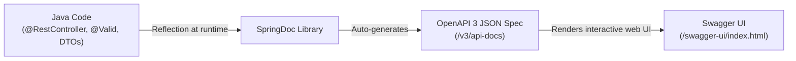

# Phase 8: OpenAPI 3 & Swagger UI Deep-Dive 📑

> [!NOTE]
> [⬅️ Back to Phase 8 Index](README.md) \| [⬅️ Back to Notes Master Index](../README.md)

---

## 1. The Core Problem: Documentation Rot

In traditional backend engineering, developers document APIs by:
* Manually exporting a Postman collection JSON file.
* Writing Markdown files or Wiki pages (Confluence/Notion).
* Typing sample JSON request and response payloads by hand.

### The Fatal Flaw: "Documentation Rot"
The moment a developer renames a Java field (e.g., from `projectName` to `name`), or alters a validation constraint, the external documentation is instantly obsolete. Frontend engineers build against outdated contracts, requests fail, and endless debugging ensues.

---

## 2. The Solution: OpenAPI 3 + Swagger UI + SpringDoc



### The Separation of Responsibilities:
1. **OpenAPI 3 (The Specification):**
   * A vendor-neutral, machine-readable standard (JSON/YAML) defining API endpoints, request bodies, query parameters, HTTP response codes, and security schemes.
   * Accessible in DevOpsHub at: `http://localhost:8080/v3/api-docs`.
2. **Swagger UI (The Presentation Layer):**
   * An interactive web application that reads the OpenAPI 3 specification and renders a visual, clickable dashboard in the browser.
   * Accessible in DevOpsHub at: `http://localhost:8080/swagger-ui/index.html`.
3. **SpringDoc OpenAPI (The Auto-Scribe):**
   * The Spring Boot starter (`springdoc-openapi-starter-webmvc-ui`) that uses Java reflection to scan our controllers, methods, and DTOs to generate the OpenAPI JSON dynamically without manual maintenance.

---

## 3. Architecture & Implementation

### A. The Maven Dependency (`pom.xml`)
For Spring Boot 4 and Java 21, we use `springdoc-openapi-starter-webmvc-ui` version `3.1.1`:

```xml
<dependency>
    <groupId>org.springdoc</groupId>
    <artifactId>springdoc-openapi-starter-webmvc-ui</artifactId>
    <version>3.1.1</version>
</dependency>
```

---

### B. Spring Security Door Rules (`SecurityConfig.java`)
Because Spring Security blocks all unauthenticated requests by default, Swagger assets must be explicitly whitelisted:

```java
.authorizeHttpRequests(auth -> auth
    // Public doors: Auth + Interactive Swagger/OpenAPI Documentation
    .requestMatchers("/api/auth/**").permitAll()
    .requestMatchers("/v3/api-docs/**", "/swagger-ui/**", "/swagger-ui.html").permitAll()
    
    // Protected doors
    .requestMatchers(HttpMethod.GET, "/api/projects/**").hasAnyRole("USER", "ADMIN")
    .requestMatchers(HttpMethod.POST, "/api/projects/**").hasRole("ADMIN")
    .requestMatchers(HttpMethod.DELETE, "/api/projects/**").hasRole("ADMIN")
    .anyRequest().authenticated()
)
```

---

### C. The JWT Authorize Scheme (`OpenApiConfig.java`)
Without explicit security scheme configuration, Swagger UI cannot send JWT tokens. We define a global `BearerAuth` scheme:

```java
@Configuration
public class OpenApiConfig {

    @Bean
    public OpenAPI devOpsHubOpenAPI() {
        final String securitySchemeName = "BearerAuth";

        return new OpenAPI()
                .info(new Info()
                        .title("DevOpsHub Developer Platform API")
                        .description("Production-grade RESTful APIs for DevOpsHub managing projects, teams, tasks, and authentication.")
                        .version("v1.0.0")
                        .contact(new Contact().name("DevOpsHub Engineering").email("engineering@devopshub.com"))
                        .license(new License().name("Apache 2.0").url("https://www.apache.org/licenses/LICENSE-2.0.html")))
                // Enable global security requirement for the "Authorize" lock button
                .addSecurityItem(new SecurityRequirement().addList(securitySchemeName))
                .components(new Components()
                        .addSecuritySchemes(securitySchemeName, new SecurityScheme()
                                .name(securitySchemeName)
                                .type(SecurityScheme.Type.HTTP)
                                .scheme("bearer")
                                .bearerFormat("JWT")
                                .description("Enter your JWT token (without 'Bearer ' prefix). Obtain one via POST /api/auth/login.")));
    }
}
```

---

### D. Decorating Controllers and DTOs

#### Controller Annotations:
* `@Tag(name = "...", description = "...")`: Groups related endpoints under clean visual headings.
* `@Operation(summary = "...", description = "...")`: Human-readable summary of the endpoint's purpose.
* `@ApiResponses` / `@ApiResponse(responseCode = "...", description = "...")`: Documents all expected HTTP outcomes (200 OK, 400 Bad Request, 403 Forbidden, 404 Not Found).

```java
@Tag(name = "Projects", description = "Endpoints for managing DevOps projects and services")
@RequestMapping("/api/projects")
@RestController
public class ProjectController {

    @Operation(summary = "Get all projects", description = "Retrieves a list of all registered DevOps projects. Accessible by USER and ADMIN roles.")
    @ApiResponses(value = {
        @ApiResponse(responseCode = "200", description = "List of projects retrieved successfully"),
        @ApiResponse(responseCode = "403", description = "Forbidden - invalid or missing JWT token")
    })
    @GetMapping()
    public List<ProjectDTO> getAllProject() {
        return projectService.getAllProjectS();
    }
}
```

#### DTO Annotations:
* `@Schema(description = "...", example = "...")`: Supplies realistic example payloads instead of generic `"string"` placeholders.

```java
@Schema(description = "Data Transfer Object representing a DevOpsHub project")
public class ProjectDTO {

    @Schema(description = "Unique ID of the project", example = "1", accessMode = Schema.AccessMode.READ_ONLY)
    private Long id;

    @Schema(description = "Name of the DevOps project", example = "Kubernetes Infrastructure Migration")
    @NotBlank(message = "Project name can't be empty")
    private String name;

    @Schema(description = "Current operational status of the project", example = "ACTIVE")
    @NotBlank(message = "Project status can't be empty")
    private String status;
}
```

---

## 4. Key Takeaways

1. **Zero Documentation Rot:** When you update an entity, DTO, or controller in Java, Swagger UI updates automatically on restart.
2. **Built-in Postman:** Any developer or QA engineer can click **"Try it out"** -> **"Execute"** directly in their browser.
3. **Client SDK Generation:** Frontend developers can feed `/v3/api-docs` into tools like `openapi-generator-cli` or `orval` to auto-generate 100% type-safe TypeScript API clients.
