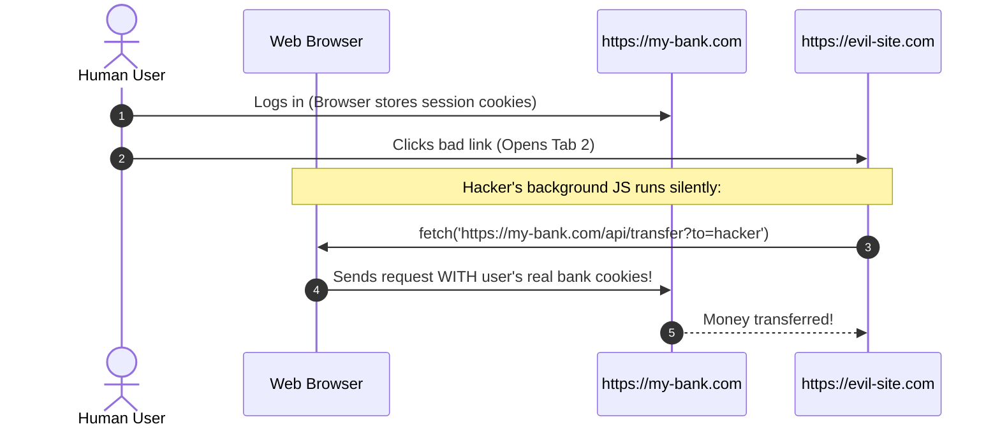
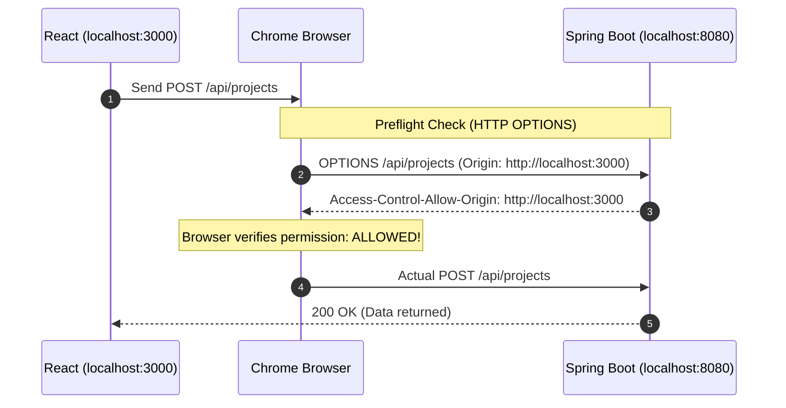

# Phase 8: CORS & Frontend Integration 🌐

> [!NOTE]
> [⬅️ Back to Phase 8 Index](README.md) \| [⬅️ Back to Notes Master Index](../README.md)

---

## 1. Why Does the Frontend Need Backend Permission?

When a frontend engineer builds a React, Vue, or Angular application on `http://localhost:3000` and attempts to call your Spring Boot backend on `http://localhost:8080`, the request will fail by default with a browser error:

> **`Access to fetch at 'http://localhost:8080/api/projects' from origin 'http://localhost:3000' has been blocked by CORS policy.`**

### The Big Question:
*Why does a frontend running in a browser need explicit permission from the backend to fetch data?*

---

## 2. The Mental Model: The "Evil Hacker Tab" Scenario

Imagine browsers had **no permission checks** between different origins:



### The Problem:
If the browser allowed JavaScript on any website to freely call APIs on any other website, malicious sites could hijack your active login sessions to steal emails, transfer funds, or delete resources without your knowledge.

---

## 3. The Browser Police: Same-Origin Policy (SOP)

To prevent session hijacking, all modern browsers (Chrome, Edge, Firefox, Safari) enforce the **Same-Origin Policy (SOP)**:

> **Rule:** JavaScript on Origin A is strictly forbidden from reading data from Origin B unless Origin B explicitly returns a permission header.

### What Defines an "Origin"?
An origin is defined by three exact components: **Protocol + Domain + Port**

| Frontend Origin | Backend Origin | Same Origin? | Result |
|---|---|---|---|
| `http://localhost:3000` | `http://localhost:8080` | ❌ **Different Port** (`3000` vs `8080`) | Blocked by SOP |
| `http://devopshub.com` | `https://devopshub.com` | ❌ **Different Protocol** (`http` vs `https`) | Blocked by SOP |
| `https://app.devopshub.com` | `https://api.devopshub.com` | ❌ **Different Subdomain** (`app` vs `api`) | Blocked by SOP |
| `http://localhost:8080` | `http://localhost:8080` | ✅ **Exact Match** | Allowed (Same Origin) |

---

## 4. How CORS Grants Permission: The Preflight Handshake

**CORS (Cross-Origin Resource Sharing)** is the official mechanism where the backend tells the browser which foreign origins are trusted.



---

## 5. Crucial Insight: Why Postman Never Gets CORS Errors

* **Web Browsers (Chrome/Edge):** Enforce CORS to protect human users from malicious scripts.
* **Postman, cURL, Mobile Apps (iOS/Android):** Do **NOT** enforce CORS because they are not running untrusted third-party JavaScript inside tabs.

---

## 6. How Spring Boot Configures CORS

In Spring Boot, CORS can be configured globally in `SecurityConfig.java`:

```java
@Bean
public SecurityFilterChain securityFilterChain(HttpSecurity http) throws Exception {
    http
        .cors(cors -> cors.configurationSource(corsConfigurationSource()))
        // ... rest of security rules
        ;
    return http.build();
}

@Bean
public CorsConfigurationSource corsConfigurationSource() {
    CorsConfiguration config = new CorsConfiguration();
    config.setAllowedOrigins(List.of("http://localhost:3000", "https://devopshub.com"));
    config.setAllowedMethods(List.of("GET", "POST", "PUT", "DELETE", "OPTIONS"));
    config.setAllowedHeaders(List.of("Authorization", "Content-Type"));
    config.setAllowCredentials(true);

    UrlBasedCorsConfigurationSource source = new UrlBasedCorsConfigurationSource();
    source.registerCorsConfiguration("/**", config);
    return source;
}
```

Or for a specific controller using `@CrossOrigin`:
```java
@CrossOrigin(origins = "http://localhost:3000")
@RestController
@RequestMapping("/api/projects")
public class ProjectController { ... }
```
